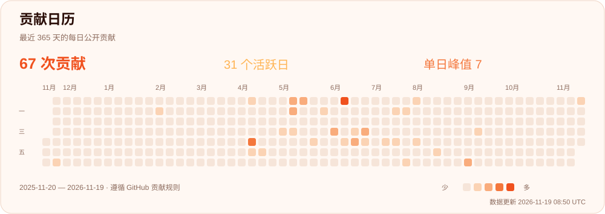
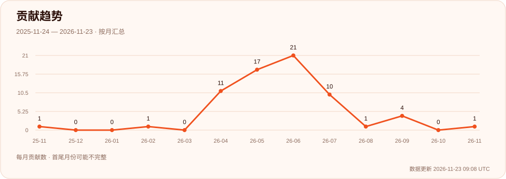
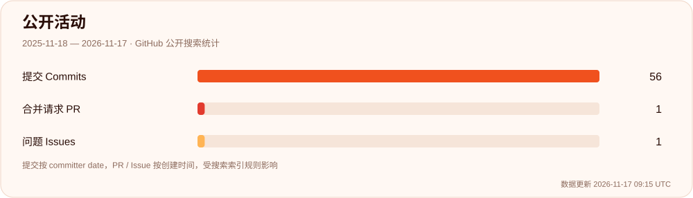
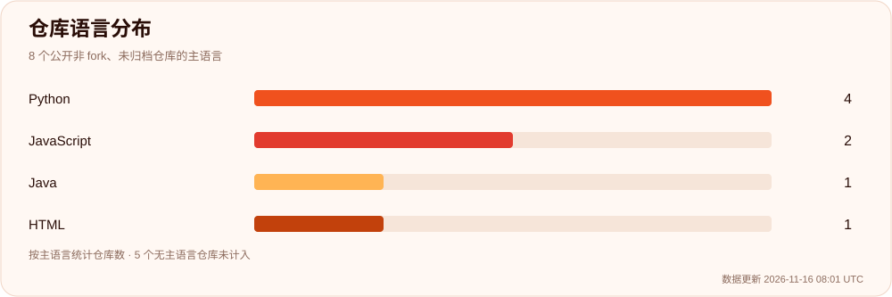
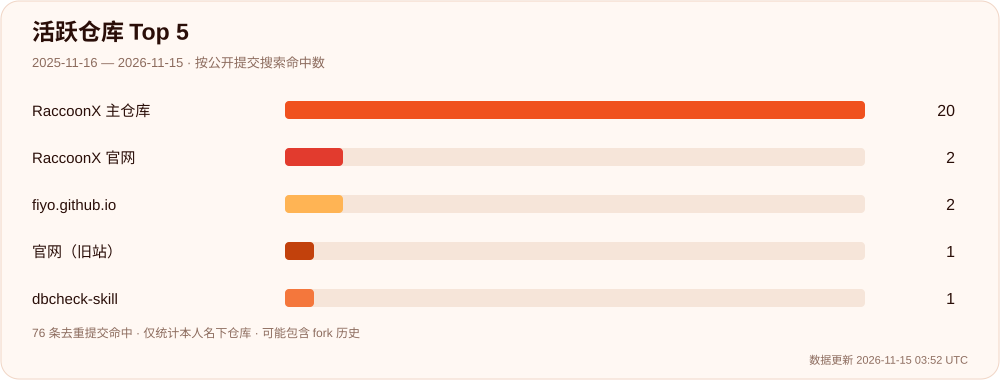

# Jack Ge

RaccoonX（浣巡）作者 · 多数据库智能巡检与运维

把复杂的数据库运维，变成一眼能看懂的结论。

[官网 raccoonx.cn](https://raccoonx.cn) · [GitHub 主仓库](https://github.com/fiyo/DBCheck) · [查看全部仓库](https://github.com/fiyo?tab=repositories)

---

## 贡献与代码分析

图表每日自动更新，时间戳显示在每张图内。贡献日历遵循 GitHub 贡献计入规则，活动数量来自公开搜索，语言按仓库主语言计数。原始数据与统计口径见 [assets/stats/data.json](assets/stats/data.json)。

## 在做什么

- **RaccoonX（浣巡）** — 面向 MySQL、PostgreSQL、Oracle、SQL Server、达梦、人大金仓、瀚高等多数据库的智能巡检平台，覆盖巡检、监控、SQL 审计与自治运维。
- **官网与文档** — 双站点维护，随版本同步发布说明与用户手册。
- **开源协作** — 欢迎 issue 反馈与贡献，社区版按 Apache License 2.0 发布。

## 找到我

官网：[raccoonx.cn](https://raccoonx.cn) · GitHub：[@fiyo](https://github.com/fiyo)
